# Fabrication samples — material tests

Part of the **Maker Faire Shenzhen 2026 version**. The goal is to compare three
filaments for the duck shell, as input to the open decision on shell materials
(see the main [README](../README.md#maker-faire-shenzhen-2026-version)).

Started 2026-11-25. Status: **TPU, PLA Silk and TPU Air printed; PETG failed on the first layer (cause unknown).** Photos below.

## Progress log

| Date | Material | Update |
|---|---|---|
| 2026-11-25 | TPU | Printing the head and body together on the Prusa MK4S. Video: [`printingonprusa20261125.mp4`](printingonprusa20261125.mp4) |
| 2026-11-25 | TPU | **Finished.** Printed in a purple/green colour-shifting TPU; head and body assembled. [Photos](#tpu) |
| 2026-11-25 | PLA Silk | **Finished.** Two ducks in dual-colour silk PLA: purple/blue and orange/red. [Photos](#pla-silk) |
| 2026-11-25 | TPU Air | New filament in: Siraya Tech Flex TPU Air (Lilac, 1 kg). Not printed yet. [Photos](#tpu-air) |
| 2026-11-25 | TPU Air | **Finished.** One-piece duck in Siraya Tech Flex TPU Air (Lilac), 8:36–11:29 pm, 2 h 52 min on the printer. [Photos](#tpu-air) |
| 2026-11-25 | PETG | **Failed.** Every attempt failed on the first layer. Cause unknown; no photos. See [PETG failure](#petg-failure) |

## What is being printed

Miriam Choi's Duck Options, 2 mm hollow version
([`cad/miriam-duck-options/`](../cad/miriam-duck-options/)):

- `Mduck_head_2mmhollow.stl` (90.6 × 69.1 × 40.8 mm)
- `Mduck_bod_2mmhollow.stl` (93.5 × 83.3 × 36.0 mm)

Each G-code file prints **both the head and the body on one plate**, even though
the file name starts with `Mduck_bod`. The parts were printed lying flat, as exported
(tallest part 40.8 mm).

## Printer and slicer

| | |
|---|---|
| Printer | Original Prusa MK4S, 0.4 mm HF nozzle |
| Slicer | PrusaSlicer 2.9.6 |
| Print profile | 0.20mm SPEED @MK4S HF0.4 (same for all three) |
| Layer height | 0.2 mm |
| Perimeters | 2 |
| Top / bottom solid layers | 5 / 3 |
| Infill | 15 % grid |
| Seam | aligned |
| Brim | none |
| G-code format | binary G-code (`.bgcode`) |

## The three samples

| | TPU | PLA Silk | PETG |
|---|---|---|---|
| G-code | [`…_FLEX_MK4S_5h3m.bgcode`](Mduck_bod_2mmhollow_0.4n_0.2mm_FLEX_MK4S_5h3m.bgcode) | [`…_PLA_MK4S_2h18m.bgcode`](Mduck_bod_2mmhollow_0.4n_0.2mm_PLA_MK4S_2h18m.bgcode) | [`…_PETG_MK4S_1h35m.bgcode`](Mduck_bod_2mmhollow_0.4n_0.2mm_PETG_MK4S_1h35m.bgcode) |
| Filament actually loaded | ZIRO Gradient Flexible TPU 1.75 mm, Flex rainbow, 0.8 kg (200–230 °C) | _not recorded_ | _not recorded_ |
| Filament profile | Prusament TPU 95A @MK4S | Generic PLA Silk @MK4S | Generic PETG @MK4S HF0.4 |
| Nozzle temp (first layer / rest) | 230 / 230 °C | 230 / 225 °C | 250 / 250 °C |
| Bed temp (first layer / rest) | 65 / 65 °C | 60 / 60 °C | 85 / 90 °C |
| Supports | **none** | yes (painted/enforced, not auto) | yes (painted/enforced, not auto) |
| Estimated time (normal / silent) | 5 h 3 m / 5 h 8 m | 2 h 18 m / 2 h 25 m | 1 h 35 m / 1 h 51 m |
| Filament used | 57.2 g (19.3 m) | 52.5 g (17.6 m) | 53.7 g (17.6 m) |
| Slicer cost estimate | 4.46 | 1.33 | 1.49 |
| Actual print time | _tbd_ | _tbd_ | _tbd_ |

Notes from the slicer settings:
- TPU is about 2–3× slower than PLA or PETG with the same print profile, because
  flexible filament has to be fed slowly.
- TPU was sliced **without supports**, while PLA Silk and PETG use supports that were
  placed by hand (supports on, auto-generation off). Overhangs on the TPU duck may
  show this.
- The slicer cost uses the price set in each filament profile, not what we paid.

## Process

1. Downloaded Miriam's Duck Options zip (see main README, Resources) and kept the
   2 mm hollow head and body, which leave room for electronics.
2. Opened both STLs together in PrusaSlicer 2.9.6 with the MK4S HF0.4 printer profile.
3. Used the same print profile (0.20mm SPEED) for all three, changing only the
   filament profile, so the results compare materials rather than settings.
4. Added supports by hand for PLA Silk and PETG; none for TPU.
5. Exported one `.bgcode` per material and printed them on the MK4S.
6. Recorded a video of the TPU print (head + body) on the MK4S, 2026-11-25:
   [`printingonprusa20261125.mp4`](printingonprusa20261125.mp4).
7. Photographed the finished TPU and PLA Silk ducks on the printer and assembled (see Photos).
8. PETG attempts all failed on the first layer (no photos taken).
9. Printed a one-piece duck in Siraya Tech Flex TPU Air on the MK4S (see [TPU Air](#tpu-air)).
10. Photographed all the ducks together (see [Final line-up](#final-line-up)).
11. _To do:_ find out why PETG failed and reprint; fill in the results below.

## Results

_Partly filled in from the photos; the rest still to be recorded._

| | TPU | PLA Silk | PETG | TPU Air |
|---|---|---|---|---|
| Print succeeded? | Yes | Yes | **No**, first layer failed | Yes |
| Surface finish | | | | Matte, visible layer lines (from photos) |
| Overhangs / support marks | | | | |
| Flexibility / feel | | | | Soft and squeezable (see video) |
| Head–body fit | Head sits on body | Head sits on body | | One piece, n/a |
| Floats? (pond test) | | | | |
| Would we use it for Shenzhen? | | | | |

### PETG failure

All PETG attempts failed on the first layer. The cause is **not known yet**.
Settings used: Generic PETG @MK4S HF0.4, nozzle 250 °C, bed 85 °C first layer
(90 °C after), 0.20mm SPEED profile, no brim.

Things to check (ideas, not confirmed):
- [ ] Which print sheet was on the bed (smooth, satin or textured), and whether it was clean
- [ ] First-layer Z offset / live adjust for PETG
- [ ] Whether the filament is dry (PETG picks up moisture)
- [ ] Whether the filament matches the Generic PETG profile (brand, temperature range)
- [ ] Bed level / first-layer calibration on the MK4S
- [ ] Try a slower first layer or adding a brim

Next time, take a photo of the failed first layer, as it helps tell these apart.

## Photos and video

- Video, TPU printing on the Prusa MK4S (2026-11-25): [`printingonprusa20261125.mp4`](printingonprusa20261125.mp4)
- Video, squeezing the finished TPU duck: [YouTube Short](https://youtube.com/shorts/AZgEm5xpuJc)

Photos are in [`photos/`](photos/), one folder per material.

### Line-up

All the ducks so far: TPU (purple/green), PLA Silk (purple/blue and orange/red), and a
smaller one-piece duck.

### TPU

Filament: ZIRO Gradient Flexible TPU 1.75 mm, "Flex rainbow", 0.8 kg, print temp 200–230 °C
(the slicer used the Prusament TPU 95A profile at 230 °C, the top of ZIRO's range).

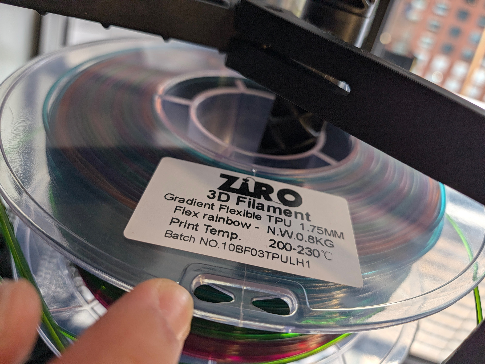

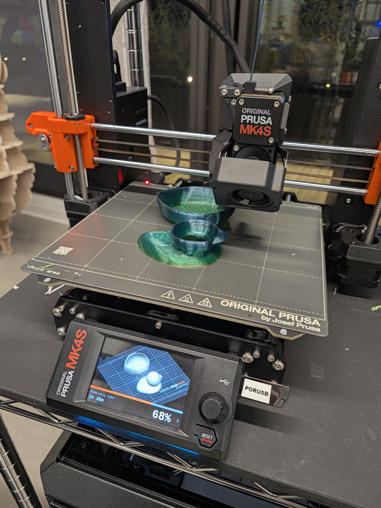 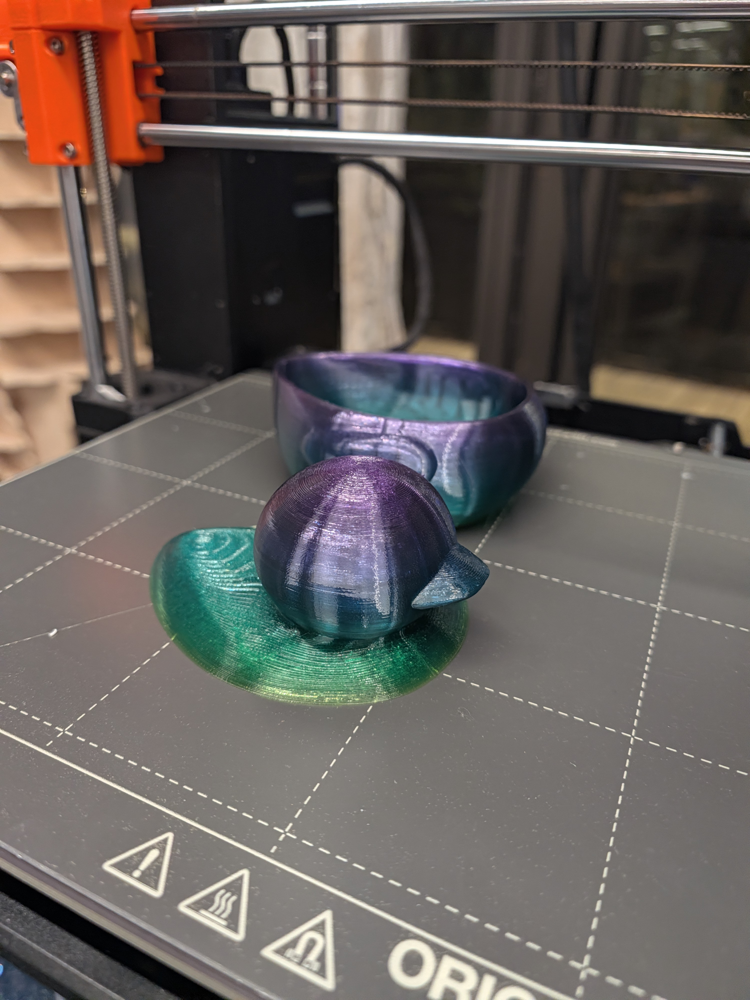 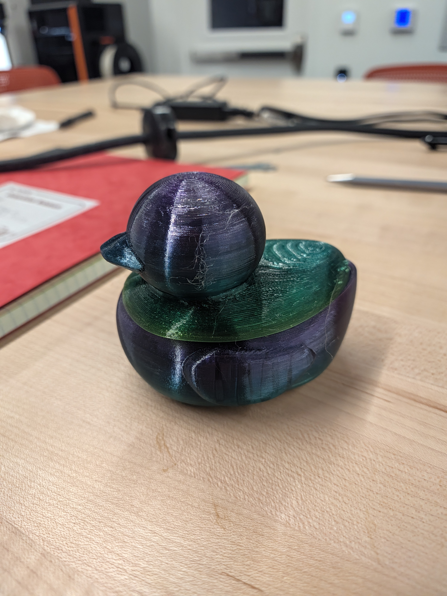

- Also: [printer view](photos/TPU/PXL_20261125_235541429.jpg),
  [assembled, second angle](photos/TPU/PXL_20261125_235625645.jpg),
  [video: squeezing the finished TPU duck (YouTube Short)](https://youtube.com/shorts/AZgEm5xpuJc)

### PLA Silk

  

- Also: [orange/red duck, close-up](photos/PLA%20Silk/PXL_20261125_213648133.jpg),
  [ducks opened up, showing the hollow inside](photos/PLA%20Silk/PXL_20261125_213958183.jpg),
  [group shot](photos/PLA%20Silk/PXL_20261126_010828470.jpg)

### TPU Air

Filament: Siraya Tech Flex TPU Air, Lilac, 1 kg (a lightweight, foaming TPU), plus boxes of black TPU.

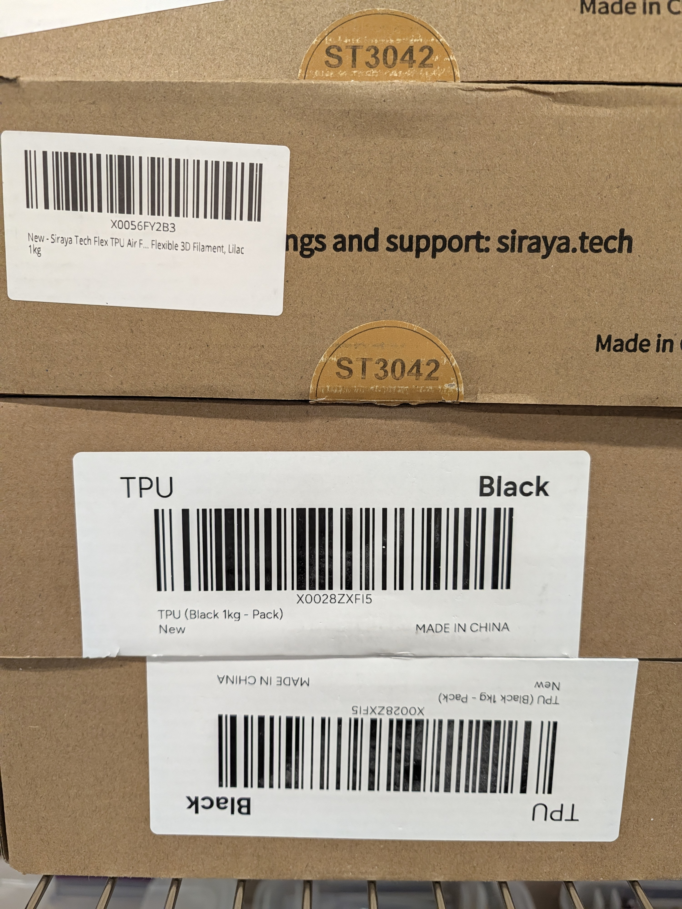 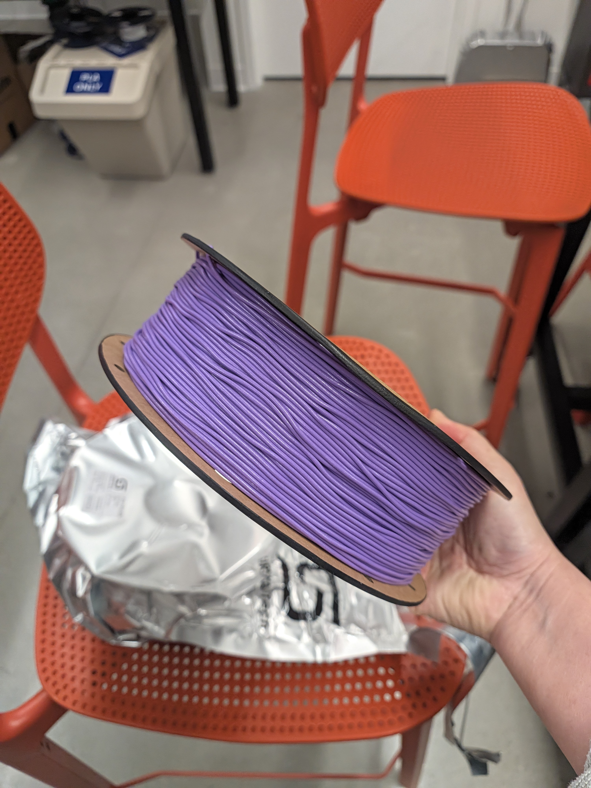

**Print, 2026-11-25:** a one-piece duck on the Prusa MK4S. The printer screen shows the job
`…v4_0.4n_0.2mm_FLEX_MK4S_2h50m.bgcode`, started 8:36 pm, finished 11:29 pm
(2 h 52 min, sliced estimate 2 h 50 min). The "v4" in the name suggests it is Miriam's
[v0 duck](../cad/miriam-duckv0/) (`duckbodyv4.stl`), not the two-part Duck Options.
The G-code for this print is not in the repo yet.

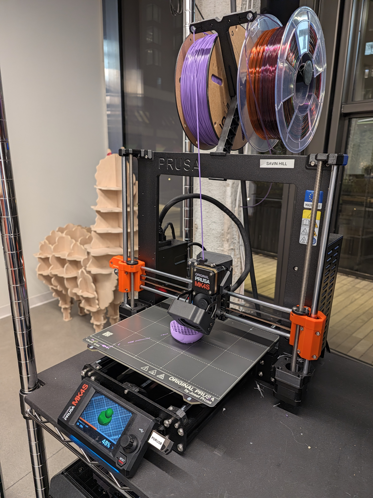 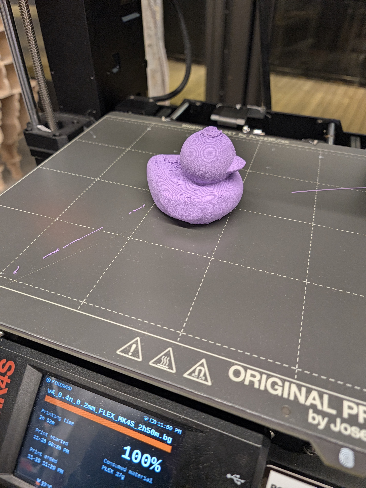 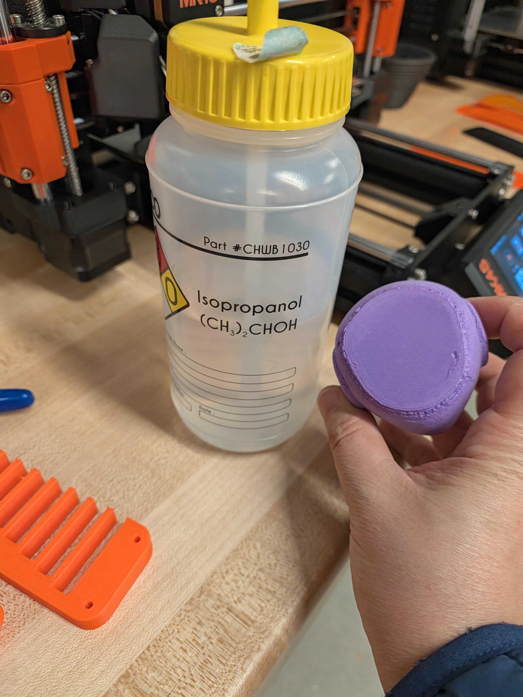

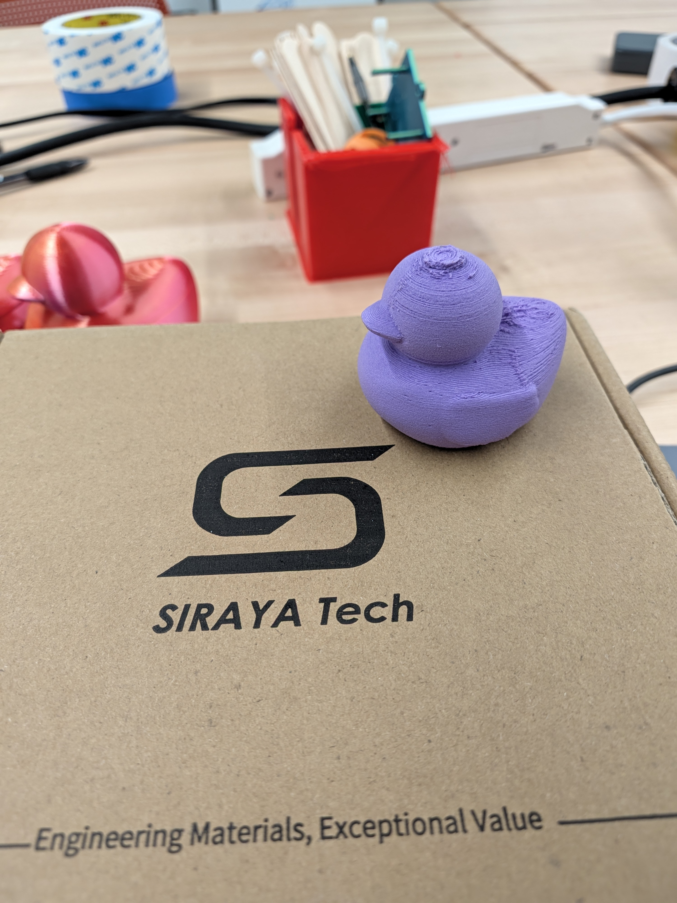 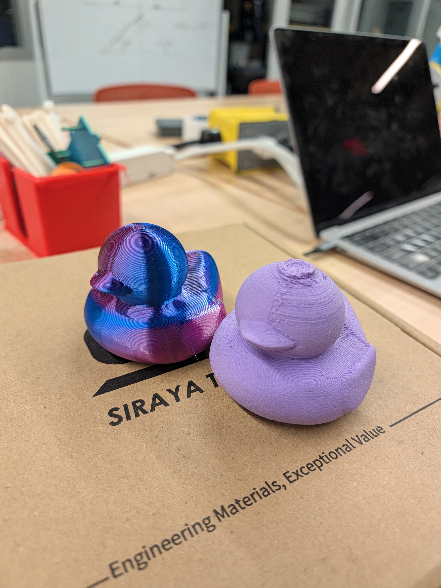

- Also: [printer, wide view](photos/TPUair/PXL_20261126_040005963.jpg)
- Video: squeezing the TPU Air duck (`PXL_20261126_040636458.mp4`, 32 s), not committed
  yet because it is 81 MB. _Link to follow._

### Final line-up

All the ducks from these tests: TPU, PLA Silk (purple/blue and orange/red), TPU Air (lilac)
and a smaller one-piece duck.

 
